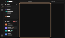

# nuoh

Herdr's own window, its spaces, agents, tabs and panels, behind a rail of views on the window's left edge, every block a card on a dark gradient, in the VJR palette: near-black cards, a gray ladder and a peach accent. Spaces shows each repository with all its worktrees as a tree, the side panel adds a git Graph beside Files and Changes, and an extra can add whole views to the rail.



## What you see

Left to right, at zoom 1. Every block sits 8px from the next and from the window's edges, on a vertical gradient from `#181818` to `#0D0D0D`, with no system title bar.

- **The rail column,** 54px: a 46px band with the macOS window buttons at `[18, 24]`, then the rail, a card on `surface` `#161616` with 16px corners, a 1px `#FFFFFF12` line and a `md` shadow. It holds 40px tiles: Search, a line, one tile per view (Workspace first), and Settings at the foot.
- **The views,** the rest of the window, showing one view at a time. **Workspace**, the first, is Herdr's window:
  - **The sidebar,** 268px (44 to 480): a 46px title band (the fold button, the shown space's avatar, name and branch), then the Spaces card over the Agents card, equal heights, each at least 90px, both on `surface` with 14px corners, the `#FFFFFF12` line and a `md` shadow.
  - **The work column:** a 46px band with the tabs (32px pills, the active one on `raised` `#1C1C1C` with a `border` `#232323` line), `+` right after them, the panel buttons in one group at the right, and a 160px slot with the machine pill. Under it, the panes: cards on `surface` with 14px corners, the `#FFFFFF12` line, `#FFC799B3` on the focused one, 8px apart, a 42px header on each, a pane alone in its tab framed too, the panes the tab hasn't selected veiled at 0.4.
  - **The side panel,** 368px (280 to 900), hidden at start: a card like the panes holding Files, Changes or Graph 6px inside it.
  - Between the sidebar and the work column, and between the two sidebar cards, a 1px line shows only under the pointer, in `accent` `#FFC799`.
- A view an extra adds fills the views area with its own mod, from the window's top.
- **Terminals:** text `#DBDBDB` on `#101010`, cursor `#FFC799`, selection `#332B24`, `terminal_padding` `[14, 12]` as Herdr's. Fonts are the person's settings, else Herdr's (JetBrains Mono 14, Geist).
- **Theme:** `vjr` in dark mode and Herdr's `paper` in light. Other colors: `raised` `#1C1C1C`, `selected` `#232323`, `hover` `#282828`, `input` `#343434`, `foreground` `#FFFFFF`, `muted` `#A0A0A0`, `unknown` `#707070`, `dim` `#505050`.
- Herdr's brand row, the sidebar's footer and the status bar are gone: search and Settings are on the rail, the fold button and the space in the title band, Add machine on the machine pill, the agent count in the Agents card.

## How it behaves

- **Agent statuses**, the same everywhere: working in `#FFC799` (`Working`), blocked in `#FF8080` (`Needs you`), done in `#99FFE4` (`Done`, until someone looks), idle in `#505050` with no chip. The rail's Workspace tile carries a dot in the most urgent agent's status, the Agents card counts `N needs you`, each pane's header shows its agent's chip, and each space's row in Spaces its status.
- **Views:** a click on a tile, or `ctrl-cmd-<n>` (1 to 9, in the rail's order), runs `layout.select` on the `views` stack; Herdr keeps the choice across restarts. Search opens nuoh's palette, a 620 x 410 popup 60px from the top that lists the `layout:nuoh` keys beside the `global` ones; Settings runs `app.settings`.
- **Back to the Workspace:** when the focused space, tab or pane changes while another view shows (a notification clicked, `agent.next`, the palette), the rail selects `workspace`. A pane that closes on its own, or a click on the rail's own tile, doesn't.
- **Panels:** the Files, Changes and Graph buttons show their panel, or hide it when it shows, and each space remembers its panels, as in Herdr's layout.
- **The window** moves by dragging either band or the tab bar's free space, and a double-click maximizes it. The fold button folds the sidebar to 44px and opens it again; below 160px the sidebar cards draw their narrow rails.
- `cmd-shift-o` opens the Markdown picker and `cmd-shift-m` the Move to… popup; a Cmd-click on a `.md` path in a terminal opens it in the Markdown viewer. After a restart, Comeback resumes the Claude Code conversations the terminals lost.
- **After a Herdr update**, the layout builds itself again within seconds, or keeps the previous copies and shows a warning toast that says why.

## Built from

`scripts/generate-layout.ts` reads Herdr's `layouts/main.json` and copies of the mods the recipes name, runs the recipes on them, and names every copy `nuoh-<name>` for `scripts/layout.ts` to install. The tree it makes:

```
root                row, gradient, padding 8, gap 8
├─ rail-column      column, 54px
│  ├─ lights        block 46px, window_drag → topbar { role: "lights" }
│  └─ rail          block, the card → rail { views }
└─ views            stack, active "workspace"
   └─ workspace     row, gap 8, hover-only divider
      ├─ sidebar    column, 268px (44 to 480), gap 8
      │  ├─ space-title    block 46px, window_drag → topbar { role: "title" }
      │  └─ sidebar-lists  column: spaces → spaces-tree, agents → agent-list
      └─ work       column, gap 8
         ├─ work-top       row 46px, window_drag: tabs → tabs, machine 160px → topbar { role: "machine" }
         └─ work-body      row, gap 8: main → { tab: "active" }, header pane-header
                           panel (column, hidden) › panel-body (stack): files → files, changes → changes, graph → git-graph
```

The root also keeps Herdr's `titlebar: "none"` and `terminal_padding`, gets `terminal_menu: "nuoh-menu"`, `link_handlers: ["nuoh-markdown"]`, `theme: { light: "paper", dark: "vjr" }`, `preview: "layouts/nuoh.svg"`, `cloned_from` and three floating blocks that draw nothing: `comeback`, `move-tab` (the worker) and `sync`. The recipes run in the order `recipes/order.ts` gives:

1. **`palette`** copies Herdr's `frame/palette` (installed as `nuoh-palette`), makes its key hints read `layout:nuoh` too, and points the key `global` binds to `app.palette` at it.
2. **`kit`** installs [`mods/kit/`](mods/kit/), the kit's gallery, with the kit's icons.
3. **`git-graph-panel`** adds the Graph button after Changes in the copy of `tabs` and a `graph` block, `git-graph`, to `panel-body`.
4. **`spaces-tree`** points `spaces` at [`mods/spaces-tree/`](mods/spaces-tree/RECIPE.md) and adds `Pin to top` and `Move to folder…` to the copy of `menu`.
5. **`comeback`** adds the floating block of [`mods/comeback/`](mods/comeback/RECIPE.md).
6. **`markdown`** installs [`mods/markdown/`](mods/markdown/RECIPE.md), adds `Open Markdown…` to the menu, makes that menu the terminal menu, sends a Cmd-click on a Markdown path to the viewer and binds `cmd-shift-o`.
7. **`move-tab`** installs [`mods/move-tab/`](mods/move-tab/RECIPE.md), adds `Move to…` to the menu and the tab drag to the tab bar, the worker's floating block, and binds `cmd-shift-m`.
8. **`files`** points the `files` block at [`mods/files/`](mods/files/RECIPE.md).
9. **`rail`** moves the window into `workspace`, the first child of the `views` stack, beside the [`rail`](mods/rail/RECIPE.md) block.
10. **The extras**, the local config's recipes, which find the window as Herdr ships it plus the steps above.
11. **`rail-keys`** binds `ctrl-cmd-<n>` to each view the rail lists.
12. **`nuoh-frame`** removes `brand`, `sidebar-footer` and `status`, paints the gradient, builds `rail-column`, `space-title` and `work-top` around [`topbar`](mods/topbar/RECIPE.md), lines the panes, and reshapes the tabs.
13. **`nuoh-cards`** makes Spaces, Agents ([`agent-list`](mods/agent-list/RECIPE.md)), the panes ([`pane-header`](mods/pane-header/RECIPE.md)) and every panel beside them cards, and gathers the panel buttons into one group.

The `layout:nuoh` section of `keys.json` takes the key `global` binds to `app.palette` (as `mod.open:nuoh-palette`), `cmd-shift-o` (`mod.open:nuoh-markdown`), `cmd-shift-m` (`mod.open:nuoh-move-tab`), and `ctrl-cmd-<n>` as `{ "command": "layout.select", "args": { "stack": "views", "child": <view> } }`.

`nuoh-sync`, from `mods/sync/`, is the `sync` block, with `{ built, repo, bun }` in its props. When it starts and `updates().app.version` differs from `built`, it runs `<bun> scripts/layout.ts apply --herdr-version <version>` in `repo` with a 120 s timeout, and on a failure posts `nuoh stayed on <built>` with the first line of the error.

The art is `layouts/nuoh.svg`; the theme is `themes/vjr.json`, generated from `palette/vjr.toml`.

## Watch out

- `~/.config/herdr-app/layouts/nuoh.json` and `mods/nuoh-*` are generated: edit `recipes/` and `mods/`, then run `bun run apply-layout`.
- Several recipes patch the same copies: `tabs` (`git-graph-panel`, `move-tab`, the extras, `nuoh-frame`, `nuoh-cards`) and `menu` (`spaces-tree`, `markdown`, `move-tab`). Each anchors on Herdr's own text and fails when that text shows up a different number of times, so a Herdr update that changed a copy stops the rebuild instead of breaking the window. The frame and the cards run last and anchor on text no extra rewrites.
- `rail` runs before the extras so an extra's view lands in `views`, and `rail-keys` after them so it gets a key. More than 9 views, or a view the stack doesn't have, fails the build.
- `exec("bun")` fails inside the app, whose PATH doesn't reach `~/.bun/bin`, so the layout stores `bun`'s absolute path and the clone's; moving the clone needs a new `apply-layout`. `exec` gives up after 30 s unless told otherwise, and the rebuild alone allows `herdr-app check` 60 s, so `nuoh-sync` passes 120 s.
- A block with `hidden: true` never starts its mod, so the three workers float and render an empty `div()`. They run only while `nuoh` is on screen.
- The gradient and the card lines are hex values, so they stay dark under the light theme.
- A node's `radius` doesn't clip the mod inside it, so the mods keep their rows inset from the cards' corners. The pane frame has no inset on Herdr 0.1.18: the terminal runs from the header to the card's line.
- `traffic_lights` is in window pixels and doesn't follow the zoom, while the band does.
- `ctrl-cmd-<n>` takes those keys from terminal programs, in `nuoh` only. Keys are derived when `apply-layout` runs.
- Name a theme differently from a layout: `themes/vjr.json` would otherwise belong to a layout called `vjr`.

## Done when

- `bun run apply-layout` prints `applied`, and running it again prints `unchanged`.
- `herdr-app do layout.switch '{"name":"nuoh"}'` shows the layout, and `herdr-app status` lists no errors.
- `~/.config/herdr-app/layouts/nuoh.json` has `rail-column` and `views` as the root's children, `views` shows `workspace`, and it has no `brand`, `sidebar-footer` or `status` node.
- The `layout:nuoh` section of `keys.json` binds `ctrl-cmd-1` to `layout.select` of `workspace`, `cmd-shift-o` to `mod.open:nuoh-markdown` and `cmd-shift-m` to `mod.open:nuoh-move-tab`.
- `herdr-app shot` shows the gradient, the rail card, the band with the window buttons, the Spaces and Agents cards, and the panes as cards with their header, the focused one lined in `#FFC799B3`.
- `herdr-app do layout.select '{"stack":"panel-body","child":"graph"}'` and then `herdr-app do layout.show '{"id":"panel"}'` show the focused repository's history in a card beside the panes.
- Changing `built` in the `sync` block's props to an older version brings it back to the installed version within seconds, with a line for it in `~/.local/state/vjr-herdr/layout.log`.
